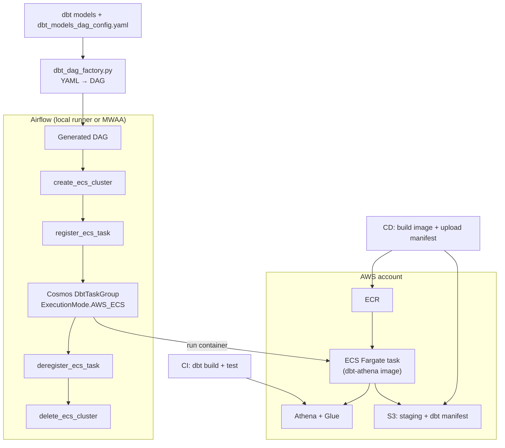

# Airflow + Cosmos → dbt on ECS Fargate

Run dbt models as short-lived ECS Fargate tasks, orchestrated by Airflow, with the
cluster and task definition created **at DAG runtime** and torn down when the run
finishes. Models and seeds are packaged into a Docker image; a YAML file defines
which models run, how, and with which resources.

This project is a self-contained, public reference implementation. It ships a
working dbt project (Athena), an Airflow local runner, a YAML → DAG factory,
GitHub Actions CI/CD with AWS OIDC, and Terraform for the AWS layer.

## Why this exists

A very common pain point is running dbt **inside the Airflow worker** (LocalExecutor,
Celery worker, or MWAA worker). dbt is memory-hungry, installs a wide dependency
tree into the Airflow environment, and competes with the scheduler for the same
resources — so a heavy `dbt build` can starve the orchestrator and every other DAG.

This project moves the dbt execution off the Airflow worker entirely: Airflow only
orchestrates, and each dbt selection runs as an isolated ECS Fargate task on its own
container image.

## What makes this different

- **Nothing to pre-provision for compute.** The DAG creates the ECS cluster and
  registers the task definition when it runs, then deregisters and deletes them at
  the end. You keep an image in ECR; everything else is ephemeral.
- **YAML-driven pipeline factory.** `dbt-models/dbt_dag_factory.py` turns a small
  YAML file into a fully wired Airflow DAG — no hand-written Cosmos boilerplate.
- **Manifest-driven rendering.** Cosmos renders task groups from `manifest.json`
  (pushed to S3 by CD), so the DAG structure always reflects the compiled dbt project.
- **Two clean execution halves.** Airflow parses the manifest; the Fargate container
  runs dbt against the image's baked project. A model change means a new image, not a
  redeployed orchestrator.

## Architecture



## Repository layout

```text
.
├── airflow-local-runner/     # Docker Compose Airflow for local testing (ECS compute)
├── dags/                     # Airflow DAGs + shared ECS operators
│   ├── dbt_models_dags/      # generated DAGs (checked in)
│   └── utils/ecs_utils.py    # create/register/run/deregister/delete ECS operators
├── dbt-models/               # dbt project + YAML→DAG factory + Dockerfile
├── infra/terraform/          # network, S3, Glue, IAM, GitHub OIDC, optional MWAA
└── .github/workflows/        # CI (dbt build/test) and CD (image + manifest)
```

## Quickstart

### 1. Prerequisites

- Python 3.12, [Poetry](https://python-poetry.org/), Docker + Compose, AWS CLI, Terraform ≥ 1.6

### 2. Configure environment

```bash
cp .env.example .env   # fill in AWS account, region, and S3 staging paths
```

### 3. Validate the dbt project locally

```bash
cd dbt-models
poetry install --no-interaction --no-root
poetry run dbt deps --target dev
poetry run dbt build --select +path:models/demo --target dev
```

### 4. Generate the Airflow DAG from YAML

```bash
cd dbt-models
python dbt_dag_factory.py        # or: make generate_demo_dag
```

Output is written to `dags/dbt_models_dags/`. The checked-in demo DAG is regenerated
from `dbt-models/dbt_models_dag_config.yaml`, and CI asserts they stay in sync.

### 5. Run Airflow locally against ECS Fargate

Build and push the dbt image, then start the local Airflow runner:

```bash
cd dbt-models
make login_ecr_docker_registry build_and_push_docker_image ENV=dev AWS_ACCOUNT_ID=<your-account-id>

make setup_airflow_locally
```

Airflow is at `http://localhost:8080` (`admin` / `admin`). Update
`airflow-local-runner/config/airflow-variables.json` first with your manifest URI,
image URI, ECS roles, network config, and Athena staging paths.

## The pipeline factory

Everything a pipeline needs lives in one YAML file. `dbt_models_dag_config.yaml`:

```yaml
model_groups:
  - name: demo_orders_pipeline
    schedule: "0 6 * * *"
    owner: "community-demo"
    description: "Run the public Athena dbt demo in ECS."
    tags: ["demo", "dbt", "athena", "ecs"]
    max_active_tasks: 2
    execution_strategy: sequential   # or "parallel" to fan out task groups
    ecs:
      cpu: 1024                      # Fargate CPU units
      memory: 2048                   # Fargate memory (MiB)
    tasks:
      - id: demo_stage
        select: "+path:models/demo/stage"
      - id: demo_analytics
        select: "path:models/demo/analytics"
```

Each `model_groups` entry becomes one DAG that:
`start → create_cluster → register_task → [task groups] → deregister_task → delete_cluster → end`.

`execution_strategy: parallel` runs the task groups concurrently (bounded by
`max_active_tasks`); `sequential` chains them.

## CI/CD

- **CI** (`.github/workflows/dbt_models_ci_pipeline.yml`): unit-tests the factory
  (generated DAG must match the checked-in DAG), then runs `dbt build`/`dbt test`
  against isolated Athena schemas. Integration runs only for trusted, same-repo runs.
- **CD** (`.github/workflows/dbt_models_cd_pipeline.yml`): assumes AWS via GitHub
  OIDC, creates the ECR repo if needed, builds/pushes the dbt image, compiles the
  project, and uploads `manifest.json`.

Set these repository **variables** (Settings → Secrets and variables → Actions):

| Variable | Purpose |
| --- | --- |
| `AWS_GITHUB_ACTIONS_ROLE_ARN` | Role CI/CD assumes via OIDC (leave empty to skip AWS steps) |
| `AWS_REGION` | Deployment region |
| `DBT_ATHENA_S3_STAGING_DIR` / `DBT_ATHENA_S3_TMP_TABLE_DIR` | Athena query staging |
| `DBT_ATHENA_CI_SCHEMA_PREFIX` | Prefix for isolated CI schemas |
| `DBT_MANIFEST_URI` | S3 URI for the compiled manifest |
| `PROJECT_NAME` / `ECR_REPOSITORY` | Naming for ECS/ECR resources |
| `MWAA_DAGS_S3_URI` | Optional: sync DAG assets for MWAA |

## Deploy the AWS layer with Terraform

```bash
cd infra/terraform
terraform init
terraform apply -var github_org=<your-org> -var github_repo=<your-repo>
```

This provisions the VPC/subnets, S3 buckets, Glue databases, ECS task roles, the
GitHub OIDC role, and the ECS log group. Feed the outputs into your dbt env vars,
GitHub variables, and `airflow-local-runner/config/airflow-variables.json`.

For the optional Managed Airflow path:

```bash
terraform apply \
  -var github_org=<your-org> \
  -var github_repo=<your-repo> \
  -var enable_mwaa=true
```

## Notes and limitations

- Compute is intentionally ephemeral, so there is a small per-run cost of cluster
  create/delete. The trade-off is zero idle infrastructure.
- The demo uses Athena/Glue and public subnets with public IPs for task egress. For
  production, prefer private subnets with NAT or VPC endpoints.
- The IAM policies are scoped for a demo; review them before production use.
- On a brand-new AWS account, the first ECS cluster creation can fail transiently with
  `Unable to assume the service linked role` while AWS provisions `AWSServiceRoleForECS`.
  Re-run the task and it succeeds.

## License

[MIT](LICENSE)
